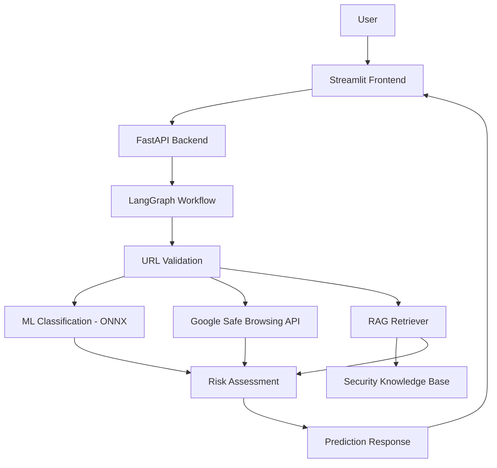

# Phishing Detection AI Agent

An AI-assisted phishing URL detection application that combines Machine Learning, Google Safe Browsing threat intelligence, LangGraph orchestration, and Retrieval-Augmented Generation (RAG) to analyze suspicious URLs and provide security insights.

## Project Overview

The Phishing Detection AI Agent analyzes submitted URLs using multiple signals:

- Machine Learning-based URL classification.
- Google Safe Browsing threat intelligence.
- RAG-based retrieval of phishing security guidelines.
- LangGraph workflow orchestration.
- Risk assessment based on available evidence.

The application provides an interactive Streamlit frontend and a FastAPI backend.

> **Important:** A legitimate ML prediction or a Google Safe Browsing no-match result does not guarantee that a URL is safe.

## Key Features

- **ML Classification:** Uses a pretrained ONNX model to classify URLs.
- **Threat Intelligence:** Integrates Google Safe Browsing API.
- **RAG Pipeline:** Retrieves relevant phishing security guidelines.
- **LangGraph Workflow:** Coordinates URL validation, classification, threat lookup, and evidence retrieval.
- **Risk Assessment:** Produces HIGH RISK, SUSPICIOUS, or UNVERIFIED outcomes.
- **FastAPI Backend:** Provides REST API endpoints.
- **Streamlit Frontend:** Provides an interactive URL analysis interface.
- **Rate Limiting:** Limits prediction requests to 10 requests per minute per client IP.
- **Request Tracking:** Generates unique request IDs and records request latency.
- **Error Handling:** Returns controlled error responses without exposing internal exception details.
- **Automated Testing:** Includes API, agent, RAG, and risk-assessment tests.
- **Docker Support:** Containerizes the FastAPI backend.

## Architecture



## Tech Stack

| Component | Technology |
|---|---|
| Programming Language | Python |
| Backend | FastAPI |
| Frontend | Streamlit |
| Workflow Orchestration | LangGraph |
| ML Inference | ONNX Runtime |
| Embeddings | Sentence Transformers |
| Retrieval | Semantic Search / NumPy |
| Threat Intelligence | Google Safe Browsing API |
| Testing | Pytest |
| Dependency Management | uv |
| Containerization | Docker |

## Project Structure

```text
phishing-detection-ai-agent/
│
├── data/
│   ├── knowledge_base/
│   ├── README.md
│   └── SOURCES.md
│
├── src/
│   └── phishing_detection/
│       ├── agent/
│       │   └── graph.py
│       ├── rag/
│       │   ├── document_loader.py
│       │   ├── embedding_service.py
│       │   └── retriever.py
│       ├── api.py
│       ├── model.py
│       ├── risk_assessment.py
│       └── streamlit_app.py
│
├── tests/
├── tools/
├── Dockerfile
├── .dockerignore
├── .env.example
├── pyproject.toml
├── uv.lock
├── evaluate_model.py
├── threshold_analysis.py
└── README.md
```

## Installation

### Prerequisites

- Python 3.10+
- uv package manager
- Docker (for containerized backend)
- Google Safe Browsing API key

### Clone Repository

```bash
git clone https://github.com/vikash1210/phishing-detection-ai-agent.git

cd phishing-detection-ai-agent
```

### Install Dependencies

```bash
uv sync
```

### Environment Configuration

Create a `.env` file in the project root:

```env
GOOGLE_SAFE_BROWSING_API_KEY=your_api_key_here
PHISHING_API_URL=http://127.0.0.1:8000
PHISHING_THRESHOLD=0.50
```

Replace the placeholder with your own Google Safe Browsing API key.

Never commit `.env` or expose API credentials publicly.

## Run Locally

### Start FastAPI Backend

```bash
uv run uvicorn phishing_detection.api:app --app-dir src --reload
```

API documentation:

http://127.0.0.1:8000/docs

Health check:

http://127.0.0.1:8000/health

### Start Streamlit Frontend

Open another terminal:

```bash
uv run streamlit run src/phishing_detection/streamlit_app.py
```

Open the local Streamlit URL shown in the terminal.

## Docker Setup

### Build Docker Image

```bash
docker build -t phishing-detection-ai:latest .
```

### Run Container

```bash
docker run -d --name phishing-detection-container -p 8000:8000 --env-file .env phishing-detection-ai:latest
```

### Check Running Container

```bash
docker ps
```

### Check Application Health

```bash
curl http://127.0.0.1:8000/health
```

Expected response:

```json
{
  "status": "healthy",
  "app": "Phishing Detection AI Agent"
}
```

### Open API Documentation

http://127.0.0.1:8000/docs

### Run Streamlit with Docker Backend

Keep the FastAPI Docker container running and start Streamlit locally:

```bash
uv run streamlit run src/phishing_detection/streamlit_app.py
```

The Streamlit frontend connects to the backend through:

`http://127.0.0.1:8000`

## API Endpoints

| Method | Endpoint | Description |
|---|---|---|
| GET | `/health` | Application health check |
| POST | `/predict` | Analyze a submitted URL |

### Prediction Request

```json
{
  "url": "https://example.com"
}
```

The response contains:

- ML prediction and phishing score.
- Retrieved security evidence.
- Google Safe Browsing status.
- Final risk assessment.
- Request tracking information in the response header.

## Risk Assessment

The application uses available signals to determine the final risk level.

| Risk Level | Meaning |
|---|---|
| HIGH RISK | External threat intelligence confirms a threat |
| SUSPICIOUS | ML classifier predicts phishing |
| UNVERIFIED | Available evidence does not establish safety |

A no-match response from Google Safe Browsing is not proof that a URL is safe.

## Model Evaluation

The pretrained ONNX model was evaluated against its associated Hugging Face dataset test split.

Recorded evaluation results:

| Metric | Result |
|---|---:|
| Accuracy | 94.86% |
| Precision | 94.76% |
| Recall | 94.96% |
| F1 Score | 94.86% |

### Threshold Analysis

The phishing classification threshold was evaluated using a validation split.

A threshold of `0.50` was selected based on validation F1 score.

An additional holdout evaluation produced:

| Metric | Result |
|---|---:|
| Accuracy | 94.43% |
| Precision | 93.65% |
| Recall | 95.33% |
| F1 Score | 94.48% |

**Evaluation limitation:** The holdout data comes from the test split associated with the pretrained model's dataset. It is not an independent real-world benchmark. These metrics should not be interpreted as guaranteed real-world detection performance.

## Testing

Run the complete test suite:

```bash
uv run pytest -q
```

Latest recorded test result:

**109 tests passed.**

## Security Considerations

- Submitted URLs are validated before processing.
- The application does not directly visit submitted URLs.
- API prediction requests are rate-limited.
- Unexpected exceptions return generic error responses.
- Request IDs help trace individual API requests.
- API credentials are stored in environment variables.
- A legitimate classification does not establish that a URL is safe.

## Current Limitations

- The application uses a pretrained model; its performance depends on the model and its training data.
- Model scores are not necessarily calibrated probabilities.
- Google Safe Browsing coverage is limited to its available threat intelligence.
- RAG retrieves general security guidance, not verified threat intelligence for a specific URL.
- Rate limiting is in-memory and process-local.
- The project is an interview-ready prototype, not a production-certified security solution.

## Future Improvements

- Independent real-world model evaluation.
- Persistent vector database for larger knowledge bases.
- Improved monitoring and deployment.
- Distributed rate limiting for multi-worker deployments.
- Further model evaluation and calibration.

## License

Review the licenses and terms of the pretrained model, datasets, and dependencies before redistributing this project or its associated assets.